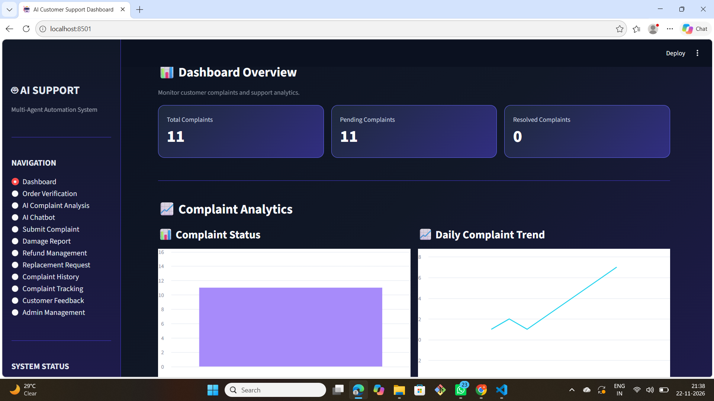
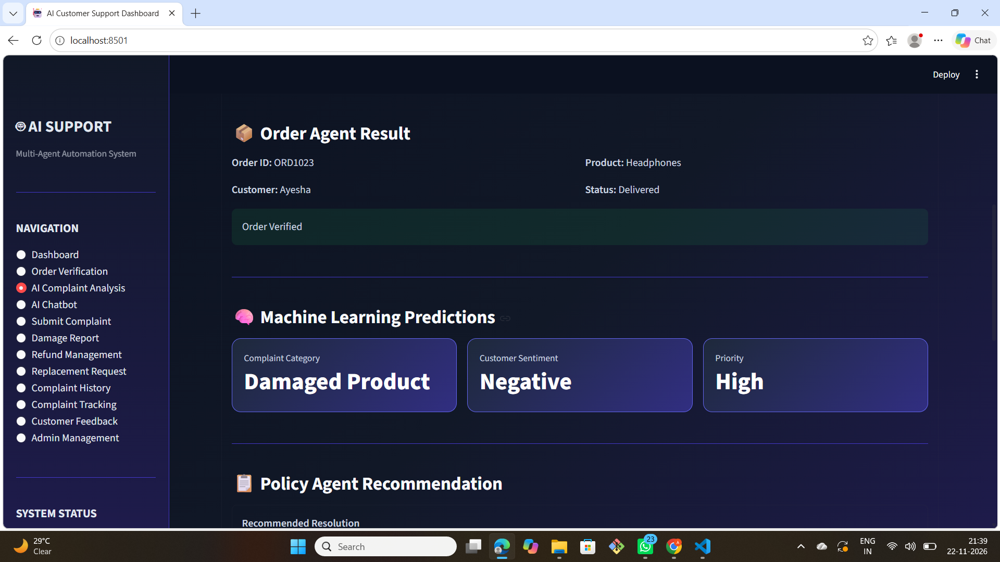
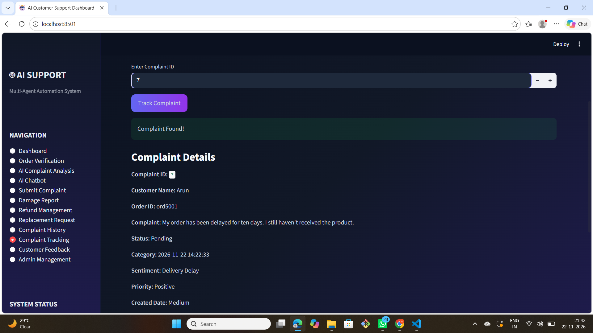
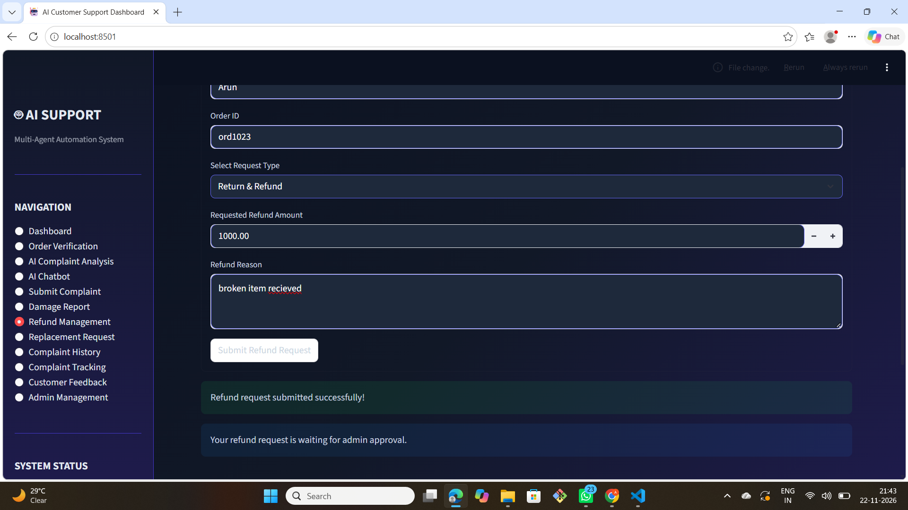

AI Customer Support Multi-Agent System

An AI-powered customer support application built using Python, Streamlit, Machine Learning, and Generative AI.

Features

- AI Complaint Analysis – Automatically categorizes complaints.
- Priority Prediction – Predicts Low, Medium, or High complaint priority.
- Sentiment Analysis – Analyzes customer sentiment.
- AI Chatbot – Provides customer support using Groq LLM.
- Order Verification – Verifies customer order details.
- Complaint Management – Submit, track, and manage complaints.
- Duplicate Detection – Detects duplicate complaints.
- Refund & Replacement – Supports refund and replacement requests.
- Damage Report – Handles product damage reports.
- Policy Agent – Provides policy-related assistance.
- Response Agent – Generates customer responses.
- Admin Dashboard – Displays analytics and complaint statistics.

Technologies Used

- Python
- Streamlit
- Scikit-learn
- Pandas
- SQLite
- Groq API
- TF-IDF
- Logistic Regression

Machine Learning Models

- Complaint Classification Model
- Priority Prediction Model
- Sentiment Analysis Model

Installation

git clone https://github.com/ayeshareemas/AI-Customer-Support-Multi-Agent-System.git

cd AI-Customer-Support-Multi-Agent-System

pip install -r requirements.txt

Run Application

streamlit run app.py

Project Type

Final Year Academic Project---

Developed as an AI-powered multi-agent customer support system.
## Project Screenshots

### Dashboard

### AI Complaint Analysis

### AI Chatbot

### Complaint Tracking

### Refund Management

### Admin Dashboard
